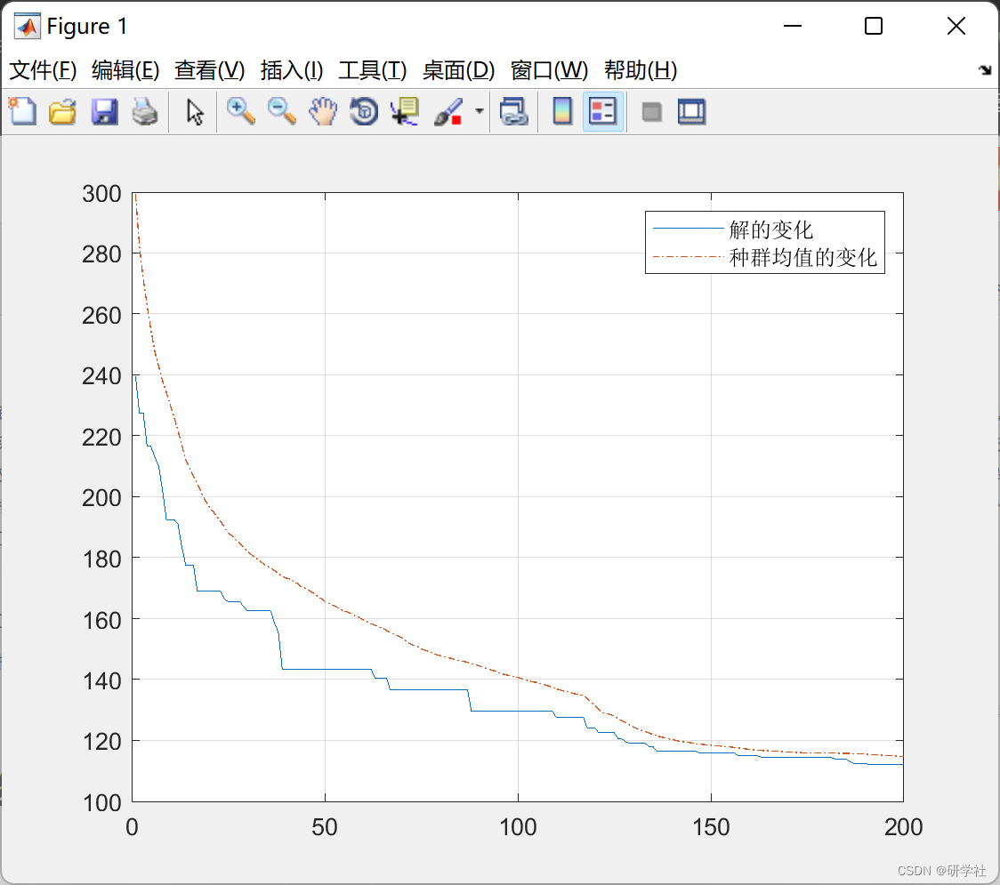
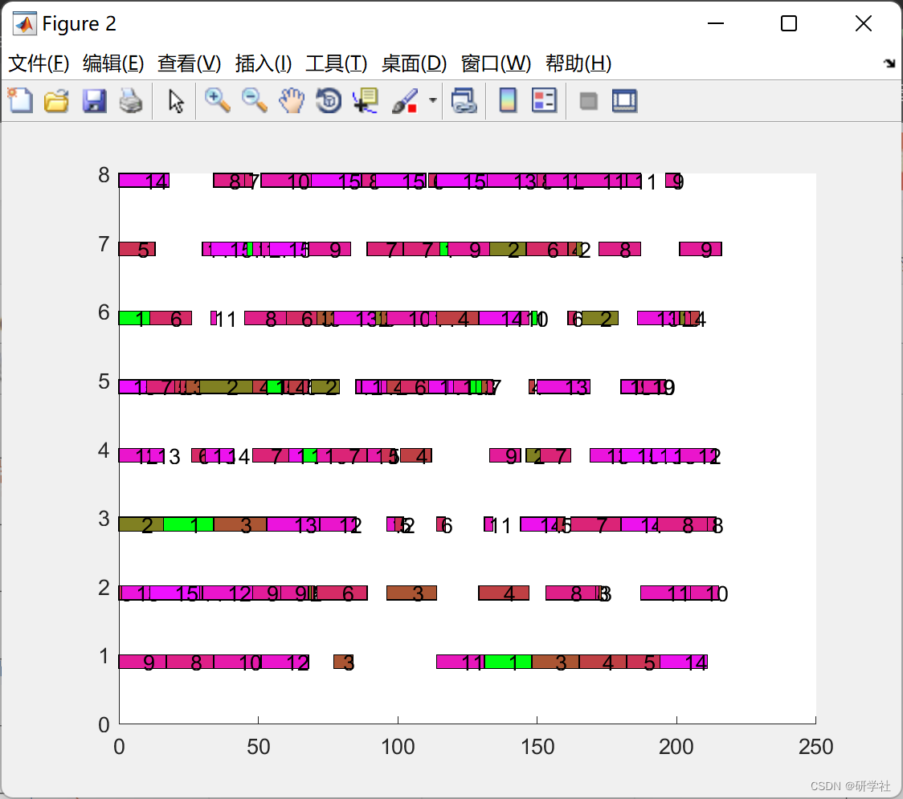
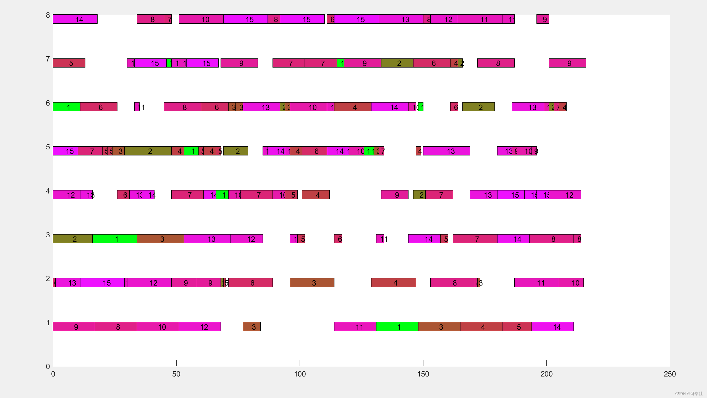

# Optimization of flexible workshop scheduling based on genetic algorithm (Matlab code implementation)

💥💥💞💞 Welcome to this blog❤️❤️💥💥
🏆 Bloggers' Advantage: 🌞🌞🌞 The content of the blog strives to be rigorous in thought and clear in logic, for the convenience of readers.
⛳️ Mantra: "Those who travel a hundred miles may arrive at the ninety-ninth mile." 📜
💥1 Overview - Production Scheduling in the Workshop as a Key Technology and Core Content Plays a Main Role in Discrete Flexible Manufacturing Production Planning. Since each enterprise's workshop production resources are limited, and workpiece processing is also constrained by equipment processes, how to reasonably arrange each workpiece's production steps on which equipment to process to ensure the best performance of the selected objectives is the purpose of scheduling. The characteristics of this problem lie in its significant discreteness, complexity, multiple constraints, and uncertainty. Traditional job shop production scheduling is difficult to achieve optimal production planning effects, which leads to low production efficiency, waste of production resources, and increased corporate production costs. Therefore, intelligent algorithms for realizing flexible workshop scheduling urgently need to be designed to improve production efficiency and enhance the market competitiveness of enterprises.
Flexible workshop production scheduling problem (FJSP) is an extension of the traditional job shop scheduling problem (JSP). This problem was introduced by Bruker and others in 1990 [21].
In JSP, each process is pre-determined, and its production equipment and time are also...
Pre-determined. In FJSP, the equipment for each process is uncertain. Each process has a set of processing equipment, from which any one can be selected for processing; and different production equipment require different times to produce the same process, which increases the flexibility of this type of scheduling problem and is common in practical production. Therefore, solving this problem is imperative.
Editor
📚2 Running Results Editing
Editor
Editor
🎉4 References
[1] Guo Qing, Zhang Minglu, Sun Lixin, Liu Xuan. Optimization of flexible workshop scheduling based on genetic algorithm [J]. Science and Technology and Engineering, 2020, 20(29): 11931-11936.
[2] Zhang Shikun, Zhu Weiyong, Xie Jun. Research on flexible workshop job scheduling based on genetic algorithm [J]. Mechanical and Electrical Information, 2013(18): 170-171.DOI: 10.19514/j.cnki.cn32-1628/tm.2013.18.110.
🌈4 MATLAB Code Implementation

## Images

<!-- PAYMENT_BLOCK -->

## Get this dataset

- Payment link (Stripe): [Buy now](https://buy.stripe.com/3cs8yP7sY87d0vu9AB)
- Payment QR code: 

<!-- /PAYMENT_BLOCK -->
